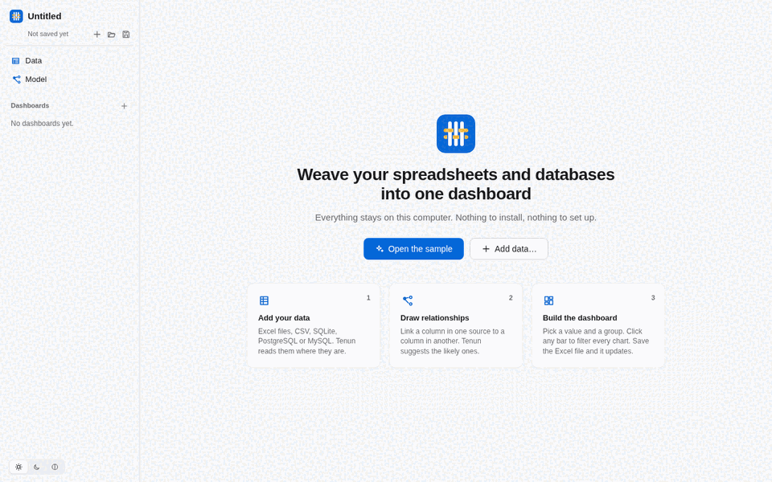
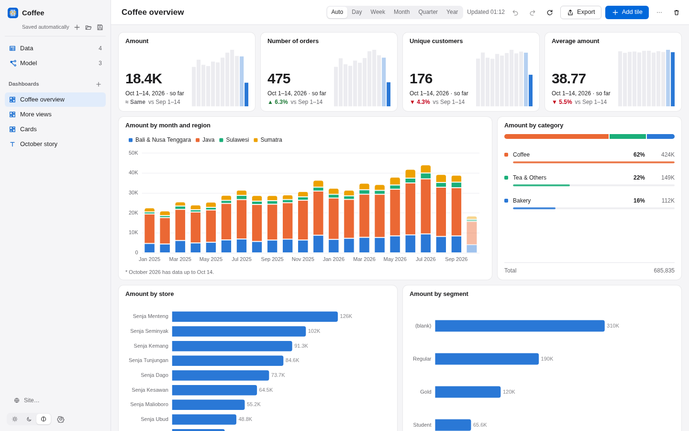
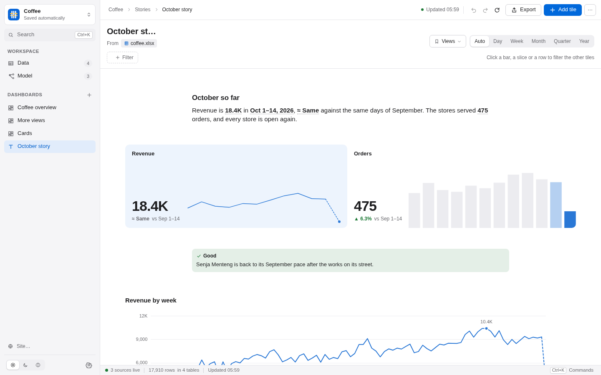
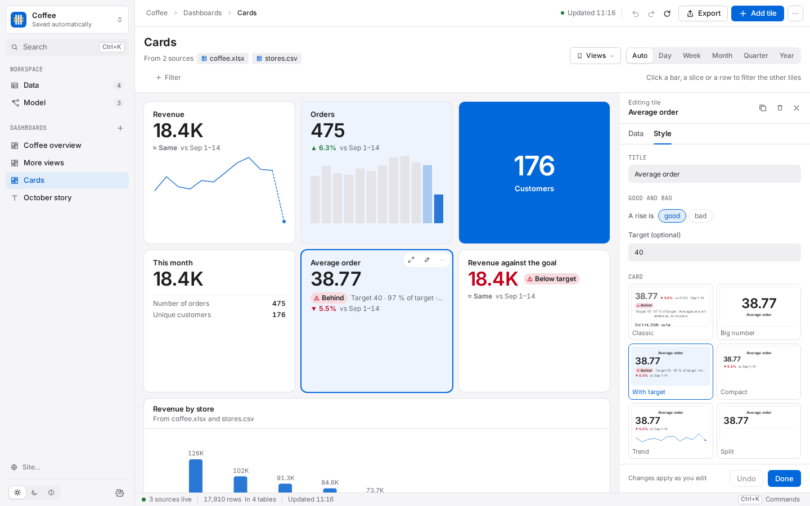
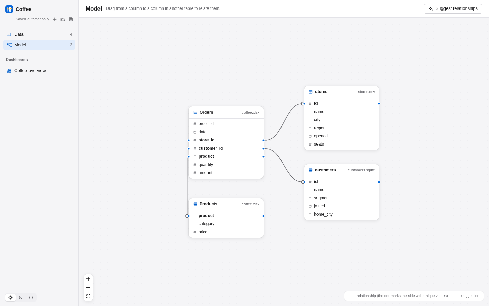
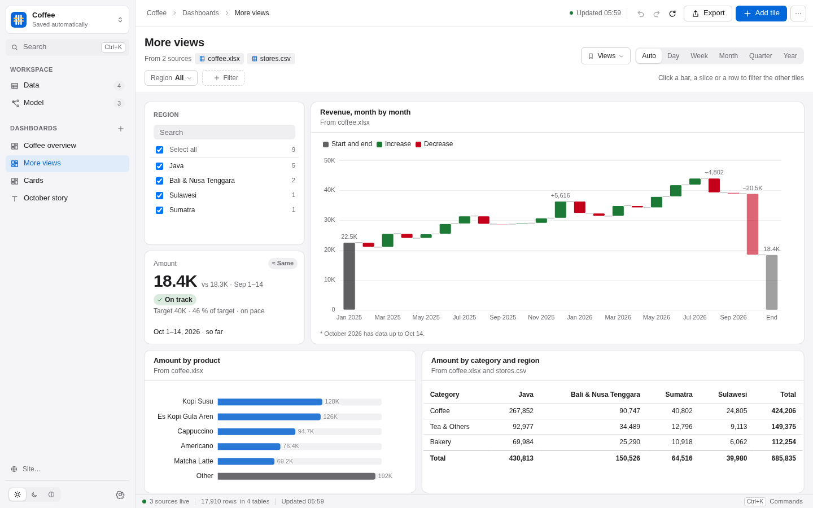
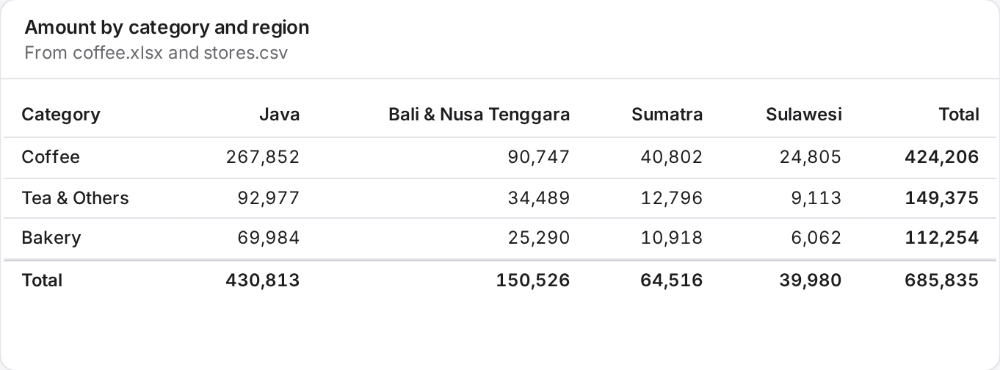
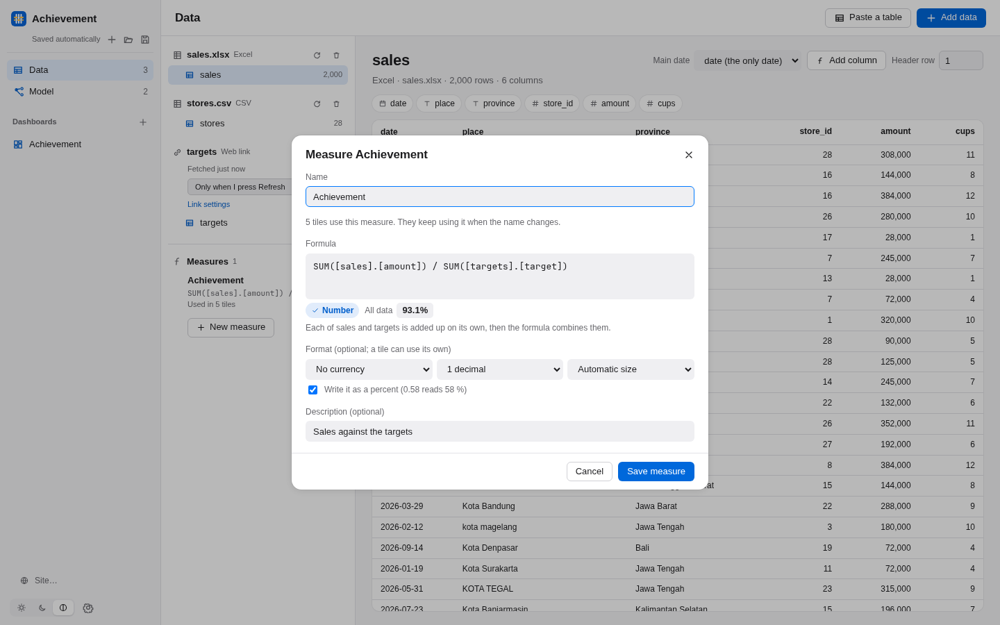
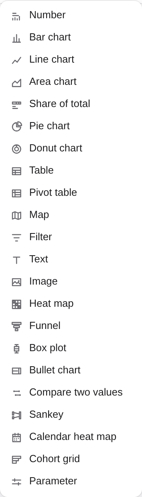
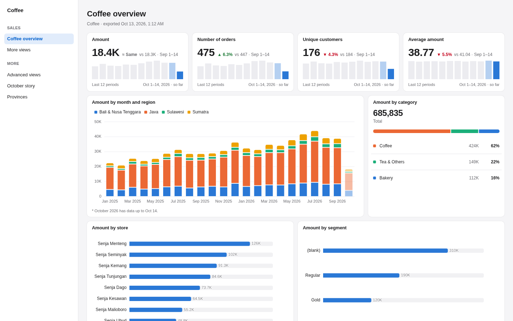

<p align="center">
  
</p>

<h1 align="center">Tenun</h1>

<p align="center"><b>Weave your spreadsheets and databases into one dashboard.</b><br>
A local app. No server, no Docker, no account.</p>

<p align="center">
  
</p>

Tenun reads your Excel files, CSV files and databases where they are. You draw a line between a
column in one source and a column in another, and every chart can use both. Click a bar and
every other chart filters. Save the Excel file and the dashboard updates.

*Tenun* is Indonesian for woven cloth.

<p align="center">
  
</p>

## Why

- **Your data is in more than one place.** Sales in an Excel file, stores in a CSV export,
  customers in a database. Most dashboard tools read one database per chart. Tenun joins them.
- **Setup should take a minute.** Download the app and open it. Everything runs on your computer.
- **Dashboards should look good without effort.** There are no colour pickers and no font menus.
  The palette is fixed and checked for colour blindness, in light and dark mode.

## What it does

- **Sources:** Excel (`.xlsx`, `.xlsm`, `.xls`, `.ods`), CSV and TSV, Parquet, SQLite, DuckDB,
  PostgreSQL and MySQL. Also a folder of CSV and Excel files (they stack into one table with a
  `file` column), a table pasted from the clipboard, and a web link to CSV or JSON data, such as a
  published Google Sheet or an API (https only, fetched again every 15 minutes, hour or day).
- **Relationships across sources:** drag from a column to a column in the Model view. Tenun
  suggests the likely ones (`store_id` → `stores.id`) and checks them against the data, again each
  time a table loads: a store id that appears twice never counts an order twice, and the link and
  its tiles say so. A one-to-one link works in both directions. Two links to one table (stock sent
  from a store, stock sent to a store) get names. A table that only links two others (programmes and funders) can be marked as a link table, so
  many to many works: a chart can group by funder, a row is under each of its funders, and the total
  counts it once. See [the relationships guide](docs/relationships.md).
- **Calculated columns (Advanced):** write `[amount] * 1.11` or `IF([region] = "Java", "West", "East")`
  once, and the new column works in charts, filters, maps and exports. 67 functions with Excel names; a
  formula can read a column of a related table. See [the formula guide](docs/formulas.md).
- **Measures (Advanced):** write `SUM([sales].[amount]) / SUM([targets].[target])` once, name it
  "Achievement", and use it in any tile, though the two tables come from different files. Tenun adds
  up each table on its own, so a target is never counted once for each sale. See
  [the formula guide](docs/formulas.md#measures).
- **New tables (Advanced):** append tables (one file for each month), merge two tables on their keys,
  or group a table. A new table never writes to your files. See [data prep](docs/data-prep.md#new-tables-from-other-tables).
- **Maps:** colour Indonesia's 38 provinces or 514 kabupaten and kota, or the countries of the world, by
  a value. Places are read from standard names and codes (`Jawa Barat`, `JB`, `32`, `Kab. Bandung`), and
  a chip lists the names Tenun could not place. Points from latitude and longitude. Click a place to
  filter. See [the map guide](docs/maps.md).
- **Charts:** number, bar, line, area, share of total, pie, donut, map and table. Also stacked,
  side-by-side and 100 % bars, scatter, histogram, waterfall, pivot table, filter, text and image
  tiles. A pie or a donut is drawn with care: at most six slices and Other, largest first, the
  share on each slice, and only for values that add up to a whole. See [the chart guide](docs/charts.md).
- **Top 5 + Other:** keep the biggest groups and add the rest as one bar, so the total stays true.
- **Show value as:** % of total, % of group, running total, moving average, change, % change, rank,
  year to date, and the same period last year as a grey line. Also median, 90th percentile, and
  a ratio of two values (amount per order).
- **Number cards:** choose the parts of a number tile, their order, size and background, and rules
  that colour the value with words ("Below target"). Six presets; card styles reuse one look on many
  tiles. See [number cards](docs/charts.md#number-cards).
- **Targets and lines:** a target on a number tile says if you are on pace. Charts can draw target,
  average, median, minimum, maximum and trend lines. Tables can show bars and good/bad colours.
- **Pivot tables** with row and column totals, in the way an Excel user expects.
- **Numbers that read right:** English and Indonesian formats (`Rp 1,2 M`, `1.234,5`), chosen for
  each workspace.
- **Data prep for messy Excel:** Tenun finds the header row, skips title and total rows, fills down
  grouped cells, turns months-as-columns into rows, and lets you rename, retype and hide columns.
  See [data prep](docs/data-prep.md).
- **Filter tiles:** a list, dropdown, number range or date range on the dashboard. **Keep only**
  and **Exclude** pin a filter. **Show rows** lists the data behind a bar.
- **Text with live numbers:** text tiles with headings, lists, quotes, callouts and links to other dashboards, and
  numbers that follow the filters: "Revenue is 18.4K in Oct 1–14, ▲ 6.3 % against the same days before."
- **Story pages:** a dashboard that reads like a document: text, live numbers, charts and cards in one column, two
  half-width tiles side by side, printed on A4 pages that never cut a chart.
- **Sites and drill-through:** turn a workspace into a site with a top bar or a sidebar, groups of pages and a home page;
  a click on a bar can open another page, kept to that bar's value. Export the whole site as one offline HTML file or
  as a folder for any web host, or publish it to tenun.cloud at one link.
- **Copy and paste:** copy tiles (Shift-click picks several, then Ctrl+C or ⌘C) or a whole dashboard, and paste
  them on any dashboard, in this workspace or another. Named measures and card styles come along. From another
  workspace, **Match fields** asks which table and column here holds the same data, with a first guess filled in.
  **Duplicate dashboard** is in the dashboard's **⋯** menu, and undo takes it back.
- **Exports:** one HTML file, a PNG or PDF of the dashboard, a PNG of one tile, and the numbers of
  a tile as CSV or Excel.
- **Works on a phone-width screen,** with keyboard and screen reader support.
- **Honest comparisons:** a number tile says which period it covers and compares it fairly. If
  October is only half over, it compares October 1–14 with September 1–14, not with all of
  September. Charts draw an unfinished last period dashed or lighter, with a note.
- **Click to filter:** click a bar, a share or a table row, and every other tile filters, across sources.
- **Live:** saving an Excel or CSV file updates open dashboards in under a second. Databases
  refresh on an interval you choose.
- **Export to one HTML file:** it opens offline, anywhere, and click-to-filter still works.
- **Two ways to run it:** the desktop app, or `tenun serve` in your browser.

<p align="center">
  
</p>

<p align="center">
  
</p>

<p align="center">
  
</p>

## Simple and Advanced

Tenun shows the common things by default. It keeps the rest behind one switch: **Advanced
features** in Settings. The switch is free, and nothing is locked. It only shows more controls.

- **Simple** has everything in the list above.
- **Advanced** adds calculated columns (a formula, or SQL), measures, a main date for each table,
  and new tables made by append, merge or group. It adds heat map, funnel, box plot, bullet chart,
  compare two values (dumbbell and slope), Sankey, calendar heat map, cohort grid and Gantt chart. It
  also adds small multiples, separate panels and indexed lines for values with different units, bars
  plus a line, bubble size, a trend column in tables, pivot groups that open and close, standard
  deviation, a manual sort order and reference bands.
- A dashboard made with Advanced features opens and works with the switch off. You only cannot edit
  those parts until you turn it on. Exported files show them either way.

<p align="center">
  
</p>

<p align="center">
  
</p>

<p align="center">
  
</p>

<p align="center">
  
</p>

## What Tenun does not do, on purpose

Tenun aims to do a few things well. These are left out by choice. Each has an answer.

| Not included | What to use |
|---|---|
| Gauges | A number tile with a target. |
| Dual-axis charts | Separate panels, or indexed lines, so each value keeps an honest axis. |
| Treemaps and packed bubbles | A bar chart with the top 10 and Other. |
| Pareto charts | A sorted bar chart with a running total. |
| Radar, 3D, ribbon and word cloud charts | A bar, line or table. |
| Custom colours, themes and fonts | The fixed palette. It is checked for colour blindness, in light and dark mode. |
| Free-floating layout | The grid. Tiles snap into place and never overlap. |
| Third-party visuals, and R or Python visuals | The built-in charts. Everything is computed in one place, so every export agrees. |
| Roles and governance | Your own files and your own permissions. Tenun runs on your computer. |

## Install

**Desktop app:** download it from [Releases](https://github.com/galohot/tenun/releases).

| System | File |
|---|---|
| Windows | `Tenun_x.y.z_x64-setup.exe` or `.msi` |
| macOS (Apple silicon) | `Tenun_x.y.z_aarch64.dmg` |
| macOS (Intel) | `Tenun_x.y.z_x64.dmg` |
| Linux | `.AppImage` or `.deb` |

The apps are not code-signed yet:

- **macOS:** open the app once and close the warning. Then open **System Settings → Privacy &
  Security**, scroll down, and choose **Open Anyway**. You do this once. Or, in Terminal:
  `xattr -dr com.apple.quarantine /Applications/Tenun.app`
- **Windows:** in the SmartScreen window, choose **More info**, then **Run anyway**.

**Command line (browser mode):** download `tenun-<version>-<platform>` from the same page, then:

```sh
tenun serve                 # opens http://127.0.0.1:4310
tenun serve sales.tenun     # opens or creates a workspace file
```

## Quick start

1. Open Tenun and click **Open the sample**. It is a small coffee chain spread over three files:
   orders in Excel, stores in CSV, customers in SQLite. The files go to `Documents/Tenun Sample`.
2. Click a store in **Amount by store**. Every other tile filters to that store. The number tiles
   show October 1–14 against September 1–14, because the sample data ends on October 14.
3. Open `coffee.xlsx` in Excel, change an amount, and save. The dashboard updates.
4. Open **Model** to see how the three files are related.
5. Open the **More views** dashboard for a top 5 + Other bar chart, a pivot with totals, a
   waterfall, a number with a target, a text note and a filter.
6. Click **Export** to save a dashboard as one HTML file, a picture or a PDF.

With your own data: **Data → Add data**, then **Model → Suggest relationships**, then a new
dashboard and **Add tile**.

## How it works

```
 Desktop window ─┐                       ┌─ Excel / SQLite / CSV → copied into memory, reloaded on save
 or your browser ─┼─► local server (Rust) ┼─ Parquet              → read on every query
                  │   + DuckDB in memory  └─ PostgreSQL / MySQL   → attached read-only, queried live
```

- The engine is [DuckDB](https://duckdb.org), embedded. Nothing is uploaded anywhere.
- A CSV file over 1 GB is read from the file on every query instead of being copied. How fast it
  all is, at 100 thousand to 10 million rows: [the benchmark](docs/benchmark.md).
- A tile asks for "this value, grouped by that column". Tenun finds the path through your
  relationships and writes one SQL query with the joins. Values are always query parameters.
- A relationship needs one side with unique values, like an ID. If neither side is unique, Tenun
  refuses the link and explains why. Such a join would count every total twice. If a key repeats
  later, Tenun reads one row for each key and shows a warning
  ([how](docs/relationships.md)). Many to many goes through a link table, a table of pairs that you
  mark in the Model view.
- A workspace is one `.tenun` file (JSON) with your sources, relationships and dashboards. File
  paths are stored relative to it, so a folder with the file and its data moves as one. It is
  safe to commit to git.

## Share online with tenun.cloud

> The **Publish** button is hidden in this release. It comes back when tenun.cloud opens. The
> `tenun publish` and `tenun agent` commands are described in [docs/agent.md](docs/agent.md).

Choose **Publish** on a dashboard to give it a private link on [tenun.cloud](https://tenun.cloud). Tenun
builds the dashboard on your computer and sends only the results: not your files, and never your
database passwords. The cloud never connects to your data.

- **Who can see it:** anyone with the link, or only people you invite (they sign in with Google).
- **Keep it updated:** when the data changes, hourly, daily, or by hand. Updates run while the app is
  open; [`tenun agent`](docs/agent.md) keeps them running on a computer that stays on.
- **Always honest about age:** every hosted dashboard says when it was updated and from which
  computer, and shows a banner when an update is late.
- **A whole site:** when the workspace is a site, **Publish** offers the whole site first: every page
  with its navigation, page links and drill-throughs, at one link (`tenun.cloud/s/…`). It has the same
  access and update settings as a dashboard.
- **Maps** go with the page, so a published map draws without any download.
- **Free:** up to 3 published dashboards and sites (a site counts as one). A dashboard can be up to
  10 MB. A site can be up to 25 MB and 10 pages.

```sh
tenun login                    # connect this computer (approve a code in the browser)
tenun publish sales.tenun      # publish now
tenun agent sales.tenun        # keep publishing on schedule
```

## Sites

A workspace can become a small website. Choose **Site…** under the dashboards and switch on **Make this
workspace a site**. It is off by default, and with it off nothing about export or publish changes.

- **Navigation:** a title, a top bar or a sidebar, groups of pages, a home page and a footer line. A page
  can stay out of the navigation and still open from a link or a click.
- **Drill-through:** in a tile's **⋯** menu, choose **On click**, then **Open <page>, keeping only the
  clicked value**. A click on a bar, a slice, a place or a row then opens that page, kept to that value. The page says where you came from,
  and **Back** returns.
- **Preview** the site in the app. Then choose **Export › Whole site (one file)**, or **Whole site
  (folder, ZIP)** for any web host. Both work offline. Offline, a drill-through holds the first 50 values of the field; past
  them the page opens as it is and says why.
- **Publish** the whole site to tenun.cloud at one link (up to 10 pages).

<p align="center">
  
</p>

## Privacy and security

- The server listens on `127.0.0.1` only. It refuses requests that name another host, which
  blocks DNS-rebinding attacks. Every change needs a header that other web pages cannot send.
- `tenun serve --host 0.0.0.0` shares Tenun on your network. It prints a link with an access
  token, and every request needs that token. Anyone with the link can read files you can read.
- Database passwords are kept in a private file in your user folder (like `~/.pgpass`), never in
  the `.tenun` file.
- Databases are opened read-only. Tenun never writes to your data.
- No telemetry. The only network use: connecting to PostgreSQL or MySQL the first time downloads
  the DuckDB connector for it, and a map of the provinces or second level of a country other than
  Indonesia downloads that country's boundaries from geoBoundaries once (the tile says so first).
  Countries, and Indonesia's provinces and kabupaten/kota, ship with Tenun.

## Build from source

You need Rust (stable), Node 22 and pnpm. On Linux the desktop app also needs WebKitGTK 4.1.

```sh
pnpm -C ui install && pnpm -C ui build    # the web UI, embedded at compile time
cargo run -p tenun -- serve               # browser mode
pnpm -C app install && pnpm -C app tauri build   # desktop app
```

The first build compiles DuckDB from C++ source and takes 10 to 20 minutes.

Checks: `cargo fmt --check`, `cargo clippy --workspace --all-targets -- -D warnings`,
`cargo test --workspace`, `pnpm -C ui check`, `pnpm -C ui build`, `pnpm -C ui test`, `pnpm -C cloud test`.

**Real-file test set.** `tests/corpus/manifest.json` lists 50 public files (open government and
open data, each with its licence) that Tenun is checked against. The files are not in the repository.

```sh
python3 scripts/corpus-fetch.py ~/tenun-corpus           # download them (checks each SHA-256)
cargo run --release --example corpus -- ~/tenun-corpus    # load every file and check what a person checked by hand
```

## Not in this version

User accounts in the app, shared servers, row-level security, scheduled emails, parameters and what-if
inputs, forecasting, and street maps under a map.

## Licence

`MIT OR Apache-2.0`, at your option. The map data comes from Natural Earth (public domain) and
geoBoundaries (CC BY 3.0 IGO), and Indonesia's codes and names from cahyadsn/wilayah (MIT): see
[NOTICE](NOTICE) and [scripts/geo/SOURCES.md](scripts/geo/SOURCES.md).
