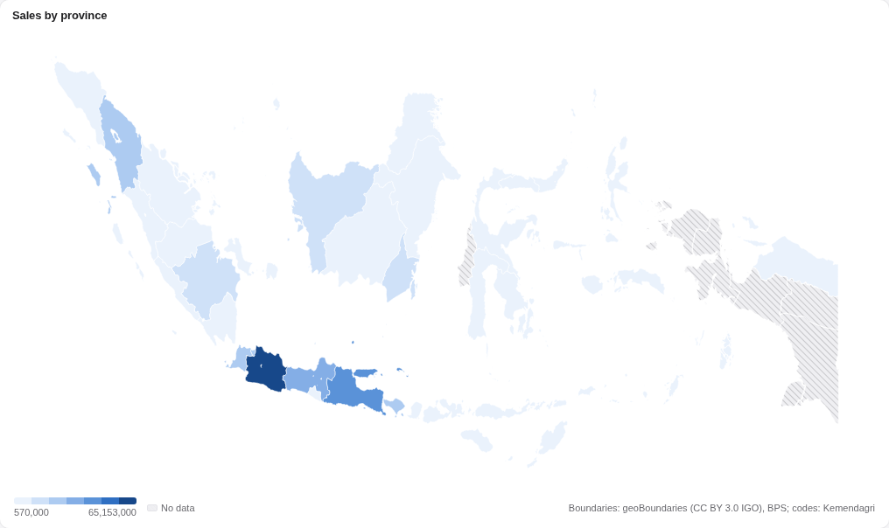
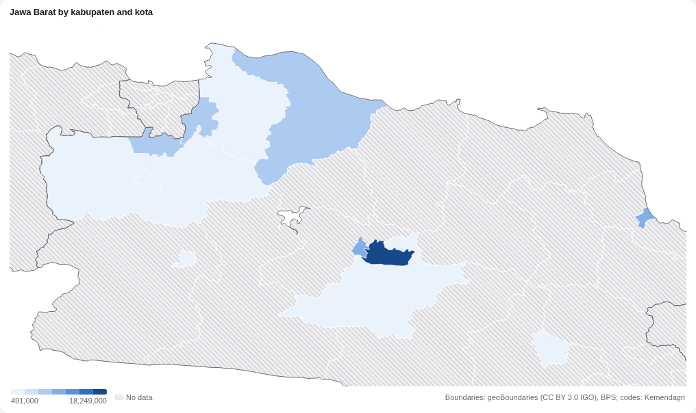

# Maps

A map tile colours each place by a value of your data: sales by province, a target by kabupaten, visitors by
country. Your data needs a column that names the place, or holds its code. This page says how to write it.

## Make a map

1. **Add tile › Map.** A new map shows Indonesia's provinces.
2. Pick the **value** (sales, a count, a measure) and the **place**: a column of names or codes.
3. In the tile's options, pick the **level**: countries of the world, provinces, or kabupaten and kota, and
   the **country** for the two lower levels.

- The places are coloured in seven steps from the lowest value to the highest. The legend under the map
  gives the range. A place with no data is grey with a fine hatch, so it never reads as a low value.
- When the values go below and above zero (a change), the colours run from blue below zero, through grey, to
  orange above.
- Point at a place for its name, its value and its rank ("4th of 38").
- **Click a place** to filter the other tiles by it, as with a bar. The filter keeps every way your data
  writes that place: "Jawa Barat", "Jabar" and "32" are one province.
- The map fits the places that have data. Filter a dashboard to one province, and a kabupaten map shows that
  province. Province borders are drawn over the kabupaten in a stronger line.

- **Names not on the map.** A chip under the map says how many names Tenun could not place ("6 names not on
  the map"). Click it for the list, with a hint for a name that is two places, and a link to the list of place
  names. Two names of one place are one place on the map, and its value is worked out over both, so an average
  is right too.
- **Points.** Choose **Points** and pick a latitude and a longitude column. Each place in your data is a dot,
  sized by the value (or by its number of rows), on the world or on Indonesia's provinces. Pick a field to
  colour the dots by; the eight biggest groups get colours and the rest is Other. Rows whose latitude or
  longitude is blank or not on the earth are left out, and the tile says how many.
- An exported file carries the maps it draws, so it works with no network.

## Levels

| Level | Places | Ships with Tenun |
|---|---|---|
| Country | Every country with an ISO 3166-1 code (237) | Yes |
| Province | Indonesia's 38 provinces | Yes |
| | The first level of any other country | Downloaded once, the first time a map needs it |
| Kabupaten / kota | Indonesia's 514 kabupaten and kota (416 kabupaten, 98 kota) | Yes |
| | The second level of any other country | Downloaded once, the first time a map needs it |

## How to write a place

Tenun follows the standards, and reads the usual ways people write them.

**Countries.** The ISO 3166-1 code (`ID`, `MZ`), the three-letter code (`IDN`, `MOZ`), the English name
(`Indonesia`, `Mozambique`) or the Indonesian name (`Amerika Serikat`, `Mozambik`).

**Provinces of Indonesia.** The ISO 3166-2 code, with or without `ID-` (`ID-JB`, `JB`), the Kemendagri number
(`32`), the official name (`Jawa Barat`), or a usual form: `Jabar`, `West Java`, `DKI Jakarta`, `Jakarta`,
`DIY`, `Yogyakarta`, `Jogja`, `NAD`, `Babel`, `Kepri`, `NTB`, `NTT`. "Provinsi" in front is fine. The four
provinces of Papua made in 2022 are there: Papua Selatan (`ID-PS`), Papua Tengah (`ID-PT`), Papua Pegunungan
(`ID-PE`) and Papua Barat Daya (`ID-PD`).

**Kabupaten and kota.** The Kemendagri code, with or without the dot (`32.04`, `3204`), or the official name
(`Kabupaten Bandung`, `Kota Bandung`).

- Case, extra spaces, dots and dashes do not matter: `kab. bandung`, `KABUPATEN  BANDUNG` and
  `Kabupaten Bandung` are one place.
- `Kab.`, `Kab` and `Kabupaten` are one word, and so are `Kota`, `Kodya` and `Kotamadya`. `Kep.` is
  `Kepulauan`.
- Names written apart or together are one name: `Banyu Asin` and `Banyuasin`, `Baubau` and `Bau Bau`.
- The official name of a city of Jakarta is "Kota Administrasi Jakarta Pusat". `Kota Jakarta Pusat` and
  `Jakarta Pusat` are read too. So are `Pangkalpinang`, `Palangka Raya` and the other usual forms.
- A kabupaten with a new name is found by its old one too: `Toba Samosir` (now Toba), `Mamuju Utara`
  (Pasangkayu), `Maluku Tenggara Barat` (Kepulauan Tanimbar).
- A name with no `Kabupaten` or `Kota` in front works when only one place has it: `Banyuasin`.
- **A name that is a kabupaten and a kota needs one of them.** `Bandung` alone could be Kabupaten Bandung or
  Kota Bandung, so it stays unmatched, and the tile says *Write Kabupaten Bandung or Kota Bandung.* There are
  26 such names, among them Bogor, Bekasi, Malang, Semarang, Kediri and Tangerang.
- A typo stays unmatched. Tenun does not guess.

## The list of names

**Settings › Place names for maps** lists the standard name and code of every place, and the other forms Tenun
reads, with a search box. **Download CSV** saves the list you see, to start a sheet from or to look up a code.

## Where the maps come from

| Map | Source | Licence |
|---|---|---|
| Countries | Natural Earth, admin-0 countries, 1:50m | Public domain |
| Indonesia's kabupaten and kota | geoBoundaries gbOpen (from BPS, the World Food Programme and OCHA), boundaries of 2020, renamed to the codes and names of 2025 | CC BY 3.0 IGO |
| Indonesia's provinces | Made from the kabupaten and kota above | CC BY 3.0 IGO |
| Indonesia's codes and names | Kepmendagri 2025, from cahyadsn/wilayah | MIT |
| Other countries' provinces and second level | geoBoundaries gbOpen, downloaded when first used | As listed on geoBoundaries |

Every map shows its credit line. A few shapes need a word:

- Lakes and reservoirs (Danau Toba, Waduk Cirata, Kedungombo) are not places, so they stay empty.
- Three areas have no ISO code: Somaliland, Northern Cyprus and Siachen Glacier. They are drawn as part of
  Somalia, Cyprus and India, as Natural Earth draws them from Indonesia's point of view.
- Australia includes Ashmore and Cartier Islands and its Indian Ocean Territories.

## A map of another country

A province or second-level map of a country other than Indonesia needs that country's boundaries. The tile says
*Downloading the map of Kenya once…*, downloads them from geoBoundaries, and keeps them in Tenun's settings
folder on this computer (`tenun/geo/`). After that the map works offline. Nothing about your data is sent: the
download asks only for the country and the level. Names are matched to the names and ISO 3166-2 codes in the
downloaded file.
